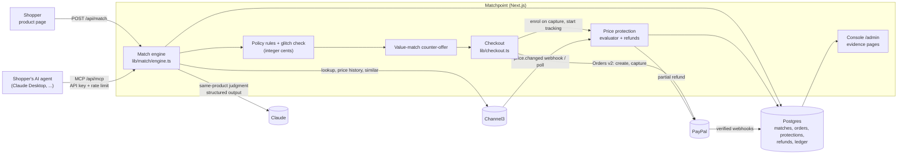

# Matchpoint

**The independent shop's negotiating agent for the age of AI shoppers.** When a customer, or the customer's own AI agent, finds a product cheaper somewhere else, Matchpoint:

1. **verifies the claim** against real product data from [Channel3](https://docs.trychannel3.com): same product, variant and condition, at an approved store, in stock, and not a one-day pricing glitch;
2. **makes the cheapest acceptable counter-offer**: a *value match* such as store credit when that costs the shop less, or a cash price match as a last resort;
3. **settles it in [PayPal](https://developer.paypal.com)**: an order created on the server at the agreed price, which the buyer approves;
4. **protects the sale**: if an approved store drops its price within the protection window, it refunds the difference automatically with a PayPal partial refund and emails the evidence.

Built for the [PayPal AI Hackathon](https://paypalaihackathon.devpost.com). The demo shop is *Larkspur & Co.*, an outdoor and audio shop in Portland. The product is described in [IDEA.md](IDEA.md) and the build plan in [PLAN.md](PLAN.md).

Money maths and policy checks run in plain code, with amounts in integer cents. Claude only judges whether two listings are the same product, citing the listing fields it read.

## Run it in demo mode (no keys, about 5 minutes)

Demo mode answers every Channel3, PayPal and Claude call from the recorded responses in [`fixtures/`](fixtures), so it needs no API keys and no accounts. You need Node.js 22.12 or later and Docker.

```bash
git clone https://github.com/Manas-33/matchpoint.git && cd matchpoint
```

```bash
npm install
```

```bash
cp .env.example .env
```

```bash
npm run db:up
```

```bash
npm run db:migrate
```

```bash
npm run seed:demo
```

```bash
npm run dev:demo
```

`db:up` starts Postgres in Docker on port 5433, which is what `.env.example` points at. Then open:

| Page | What to try |
|---|---|
| http://localhost:3000 | The shop. |
| http://localhost:3000/products/bose-quietcomfort-ultra-headphones-2nd-gen-mgo7x7f | **Found it cheaper?** Pick a recorded link under the box: *Best Buy* is matched ($359.99, with a store-credit counter-offer first), *Best Buy open-box* is declined on condition, *Crutchfield one-day low* is declined as a pricing glitch. Then check out with the simulated PayPal button. |
| http://localhost:3000/admin | Merchant console: sales covered by protection vs refunds paid, match counts, and recent decisions with a **via agent** badge. Each links to its evidence. |
| http://localhost:3000/admin/protection | Price protection: replay a recorded price drop (labelled **simulated**) on a protected order and watch the partial refund and its evidence page. |

To try the shopper-agent side from a terminal, with the dev server running:

```bash
npm run mcp:try -- http://localhost:3000/api/mcp
```

It connects over MCP, lists products, asks for a price match on the Bose headphones and prints the verdict, the evidence and the approval link.

## Let an AI agent ask for a price match (MCP)

`/api/mcp` is a [Model Context Protocol](https://modelcontextprotocol.io) server over Streamable HTTP (stateless, JSON responses). Any MCP client can use it.

| Tool | What it does |
|---|---|
| `list_products` | The catalog, with product IDs, prices and variants. Optional `query`. |
| `request_price_match` | `product`, `competitor_url`, optional `buyer_email` and `option` (`match` or `value`). Runs the same match engine as the product page and returns the decision, every check with the evidence it read, Claude's cited reasons, any value-match offer and, when matched, a **PayPal approval link** for an order created on the server at the agreed price. The agent cannot pay: the buyer opens the link and approves the payment. |
| `get_match_status` | `match_id`. The decision, the order and payment status, and price protection. |

Requests need `Authorization: Bearer <key>` (or `X-API-Key`). Keys come from `MCP_API_KEYS` as comma-separated `name:key` pairs. The name is saved on each match request and shown in the console. Demo mode accepts `mp_demo_key` when `MCP_API_KEYS` is empty. Each key is limited to 60 requests a minute.

### Connect Claude Desktop

Claude Desktop starts local servers over stdio, so [`mcp-remote`](https://www.npmjs.com/package/mcp-remote) bridges it to the HTTP endpoint. Node.js must be on your `PATH`.

1. Start the app (`npm run dev:demo`, or `npm run dev` with keys) and note the port.
2. In Claude Desktop open **Settings → Developer → Edit Config** and add this to `claude_desktop_config.json` (change the port and key if yours differ):

   ```json
   {
     "mcpServers": {
       "larkspur-price-match": {
         "command": "npx",
         "args": ["-y", "mcp-remote", "http://localhost:3000/api/mcp", "--transport", "http-only", "--header", "Authorization:${MATCHPOINT_AUTH}"],
         "env": { "MATCHPOINT_AUTH": "Bearer mp_demo_key" }
       }
     }
   }
   ```

   The key is passed through `env` because spaces inside `args` aren't passed through reliably on every platform.
3. Quit and reopen Claude Desktop. *larkspur-price-match* appears under the tools (search and tools) menu with three tools.
4. Ask, for example: *"I found the Bose QuietComfort Ultra (2nd Gen) for $359.99 at https://www.bestbuy.com/product/bose-quietcomfort-ultra-headphones-2nd-gen-black/J7C5V6W7LP. Ask Larkspur & Co. to match it."* Claude calls `list_products`, then `request_price_match`, and returns the verdict with the approval link. Open the link to pay (in demo mode it simulates the PayPal approval and shows the order), then ask Claude for the status.

In live mode the link is PayPal's sandbox approval page. After approval PayPal returns the buyer to `/api/checkout/return`, which captures the payment, enrols it in price protection and shows the order.

## Live sandbox setup

Set `DEMO_MODE=false` (the default) in `.env` and fill in these keys. Live mode refuses to start without the first three and says which one is missing ([`lib/env.ts`](lib/env.ts)).

| Key | Where to get it |
|---|---|
| `PAYPAL_CLIENT_ID`, `PAYPAL_CLIENT_SECRET` | [developer.paypal.com](https://developer.paypal.com) → Apps & Credentials → **Sandbox** → create an app. |
| `CHANNEL3_API_KEY` | [trychannel3.com](https://trychannel3.com/dashboard) → API keys. |
| `ANTHROPIC_API_KEY` | [console.anthropic.com](https://console.anthropic.com) → API keys. `ANTHROPIC_MODEL` defaults to `claude-sonnet-5-5`. |
| `PAYPAL_WEBHOOK_ID` (optional) | After adding `https://<public host>/api/webhooks/paypal` as a webhook on the sandbox app (see below). |
| `CHANNEL3_WEBHOOK_SECRET` (optional) | The `whsec_...` signing secret of a Channel3 webhook endpoint pointing at `https://<public host>/api/webhooks/channel3`. |
| `MCP_API_KEYS` | Your own `name:key` pairs for agents, e.g. `claude-desktop:<long random string>`. |
| `RESEND_API_KEY` (optional) | [resend.com](https://resend.com). Without it, evidence emails are logged. |

Then seed from live Channel3 data (this also creates the "Matchpoint approved stores" Collection in your Channel3 account) and start the app:

```bash
npm run seed
```

```bash
npm run dev
```

Pay with a PayPal sandbox **personal** account: developer.paypal.com → Sandbox → Accounts. Live prices move, so a link that matched yesterday may decline today (the recorded demo cases don't change).

**Webhooks.** Expose the app with a tunnel (e.g. `ngrok http 3000`), set `APP_URL` to the tunnel URL, and add the two webhook URLs above. PayPal deliveries are verified with `verify-webhook-signature` and stored once per event ID in `ledger_events`; Channel3 deliveries are verified with their Svix signature. Without webhooks, the protection console's **Run price check now** (or `npm run protection:check`) polls Channel3 instead. `npm run webhooks:replay` re-sends the recorded PayPal deliveries.

## Architecture



One engine serves both doors: `POST /api/match` and the MCP tool `request_price_match` call the same `runMatch` function and the same `createCheckoutOrder`; the only difference recorded is `match_requests.source` (`web` or `agent`) and the agent's key name.

## What each technology does

**Channel3** ([`lib/channel3.ts`](lib/channel3.ts), via `@channel3/sdk`)
- **Lookup** (`products.lookup`): resolves the competitor URL the shopper pasted into a canonical product with every store's **offers** (price, availability, condition).
- **Offers**: the linked store's offer gives the competitor price and stock; seeding uses offers and compare-at prices to set shop prices.
- **Price history** with `statistics.current_status` (`low` / `typical` / `high`): the glitch check declines prices seen on one day well below the 30-day typical price.
- **Price tracking and webhooks**: captured orders start tracking (`priceTracking.start`), and `price.changed` webhooks (Svix-verified) trigger the protection evaluator; a poll of history and offers is the fallback.
- **Collections**: the shop's approved stores are kept as a Channel3 Collection ("Matchpoint approved stores").
- **`similar`**: on a decline, suggests similar products the shop stocks.

**PayPal** ([`lib/paypal.ts`](lib/paypal.ts), [`lib/checkout.ts`](lib/checkout.ts))
- **Orders v2** (create, capture) through [`@paypal/paypal-server-sdk`](https://github.com/paypal/PayPal-TypeScript-Server-SDK), the APIMatic-generated Server SDK. The integration was built with the **APIMatic PayPal Context Plugin**. Amounts always come from the database, never the browser or the agent, and the captured amount is checked against the order.
- **Partial refunds** for price protection, with a stable `PayPal-Request-Id` per protection and price drop so a retry can't pay twice.
- **Verified webhooks**: `PAYMENT.CAPTURE.COMPLETED` and `PAYMENT.CAPTURE.REFUNDED` are verified with `verify-webhook-signature` and de-duplicated into `ledger_events`.
- **PayPal JS SDK v6** for the buttons on the shop's checkout page; agents get the order's approval link instead.

**Claude** ([`lib/claude.ts`](lib/claude.ts), via `@anthropic-ai/sdk`)
- Model from `ANTHROPIC_MODEL` (default `claude-sonnet-5-5`).
- **Structured outputs**: the same-product judgment is parsed against a Zod schema (same product, variant, condition, bundle, model year, confidence, and reasons that each cite a listing field). Low confidence or an unusable answer sends the request to review; it never approves a match by itself.

**Also:** Next.js 16 (App Router, TypeScript), Tailwind CSS, Postgres with Drizzle ORM, the MCP TypeScript SDK (`@modelcontextprotocol/sdk`), Resend for email, Vitest.

## Scripts

| Command | What it does |
|---|---|
| `npm run dev` / `npm run dev:demo` | Start the app in live or demo mode |
| `npm test` | Unit tests (Vitest); database tests run when Postgres is reachable, in rolled-back transactions |
| `npm run lint` / `npm run typecheck` | ESLint and TypeScript |
| `npm run db:up` / `npm run db:down` | Start or stop local Postgres (Docker, port 5433) |
| `npm run db:migrate` / `npm run db:generate` | Apply migrations / generate one from `lib/db/schema.ts` |
| `npm run seed` / `npm run seed:demo` | Seed the shop from Channel3 or from fixtures (`-- --reset` empties every table first) |
| `npm run mcp:try -- [url] [competitor link]` | Use the MCP endpoint as an agent would |
| `npm run match:record` | Re-record the demo match cases |
| `npm run protection:check` / `protection:replay -- <protectionId>` / `protection:backfill` | Poll prices, replay a simulated drop, enrol missed orders |
| `npm run webhooks:replay [url]` | Re-send the recorded PayPal webhook deliveries |

## Project layout

```
app/                    Pages: shop, checkout, orders, /admin console, /matches and /evidence pages
app/api/match           POST /api/match (JSON, or NDJSON progress with ?stream=1)
app/api/mcp             Shopper-agent MCP endpoint
app/api/checkout        Create and capture orders; /return captures after PayPal approval
app/api/webhooks        PayPal and Channel3 webhooks
lib/match/              Match engine, policy rules, value-match counter-offer, demo cases
lib/mcp/                MCP tools, API keys and rate limit
lib/price-protection.ts Enrolment, price events, refunds; lib/protection.ts is the pure evaluator
lib/paypal.ts           PayPal Server SDK client (and the demo-mode stand-in)
lib/channel3.ts         Channel3 client (and the demo-mode stand-in)
lib/claude.ts           Same-product judgment
lib/db/                 Drizzle schema; migrations in drizzle/
fixtures/               Recorded API responses (secrets redacted) for demo mode and tests
scripts/                Seed, recording, replay and MCP scripts; Phase 0 spikes
```

## Known limitations

- **Replayed and simulated price drops are labelled.** The protection console's replay injects a recorded Channel3 payload with a made-up lower price. It's marked *SIMULATED* in the console, on the evidence page, in the email and in the PayPal refund note. The *Crutchfield one-day low* demo case is also constructed by hand and only offered in demo mode.
- **Price tracking only covers products in Channel3's catalog.** Lookup works on any product URL, but only catalog products can be tracked or passed to `similar`, so price protection covers products Channel3 can verify and track.
- PayPal runs in the **sandbox** only.
- Live prices change: the recorded Best Buy match in demo mode no longer matches live, because Best Buy's price has since gone up.
- The console and admin routes have no login; it's a single-shop demo.
- The MCP rate limit is in memory, per app instance.

## Commission disclosure

Channel3 product data includes buy links (`buy.trychannel3.com`) that are affiliate links: a purchase through one may earn a commission. Matchpoint doesn't send shoppers through those links: it links only to the shop's own pages and to the competitor URL the shopper gave it. If you add Channel3 buy links to your storefront, show a commission disclosure next to them.

## License

[MIT](LICENSE)
