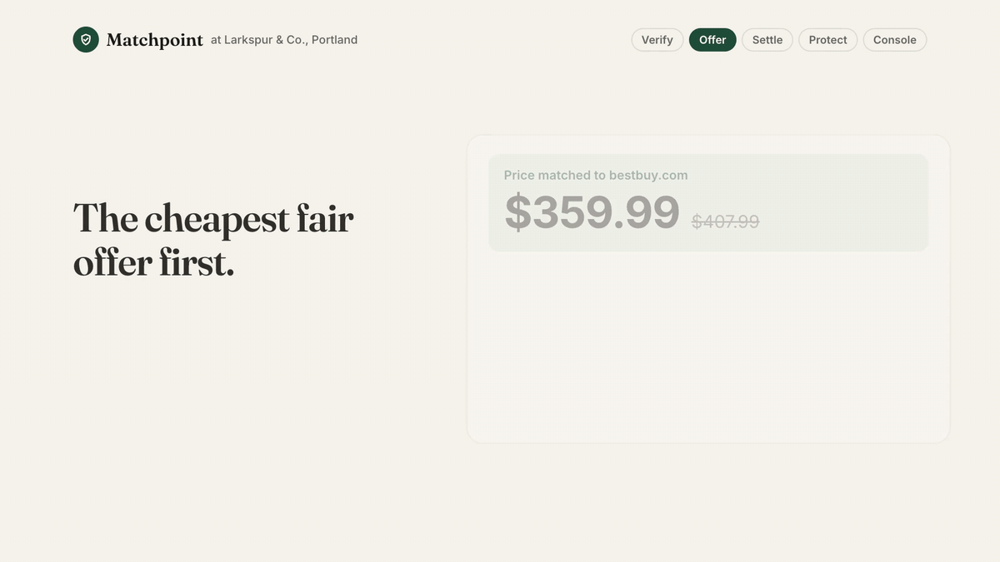
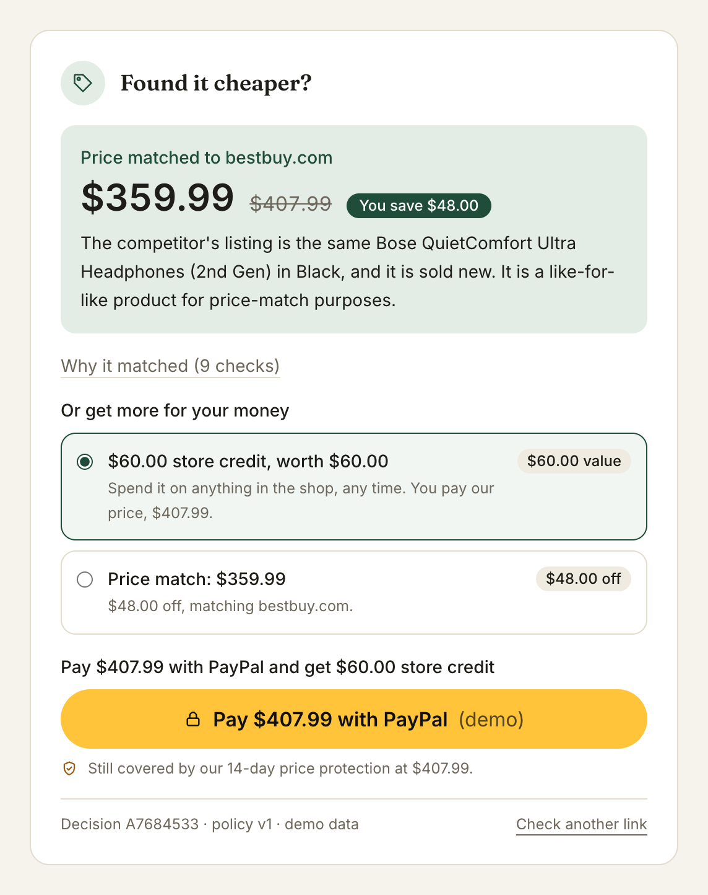
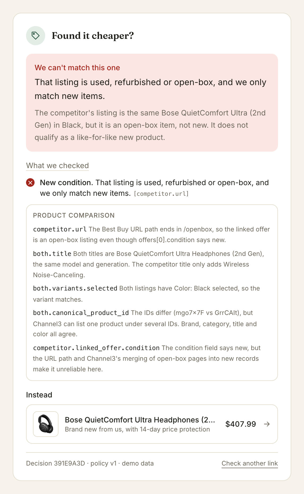
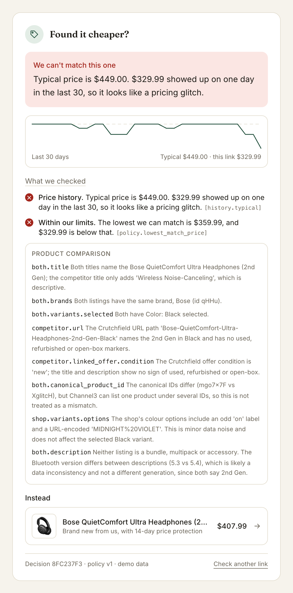
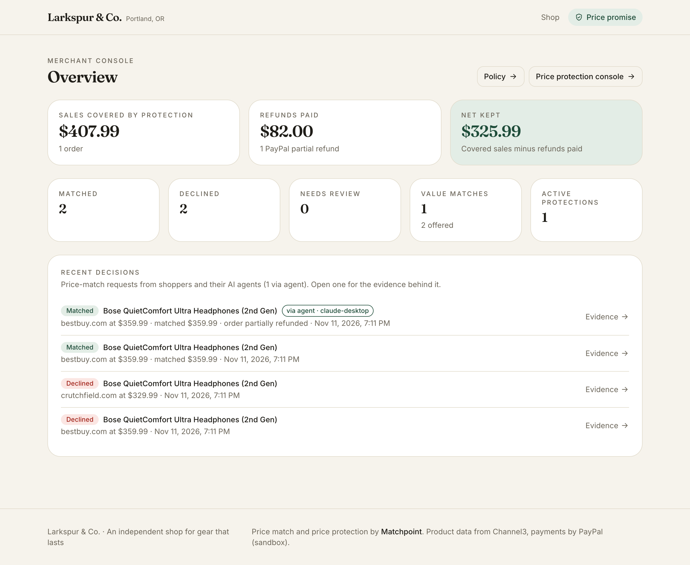
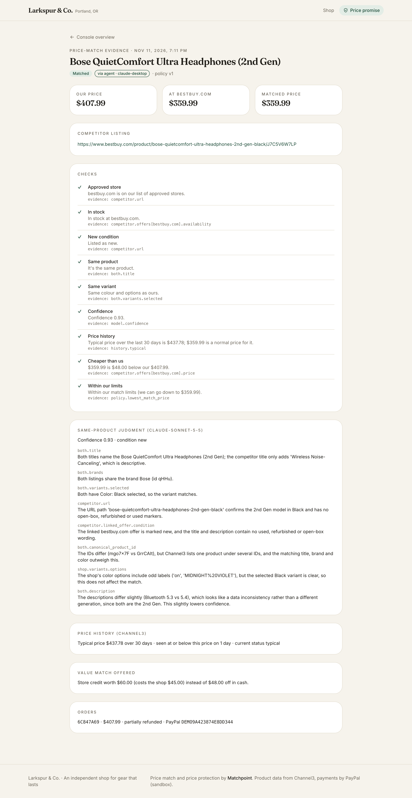
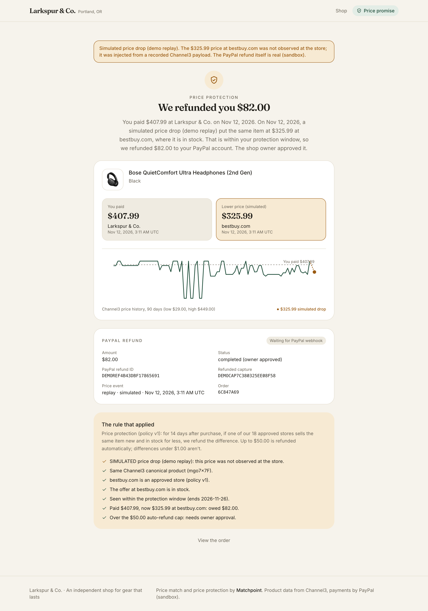
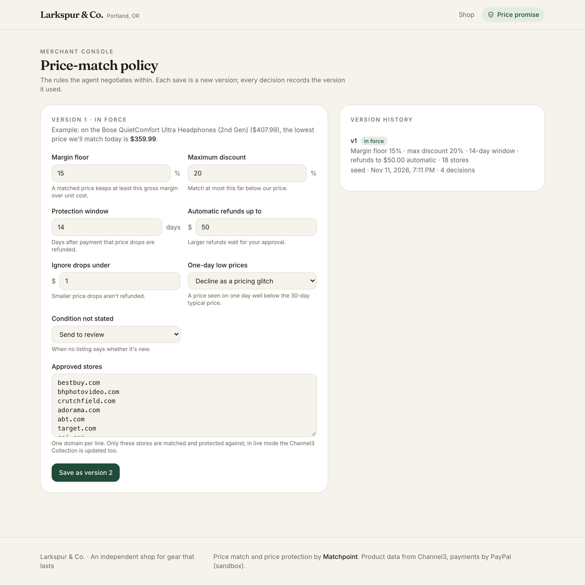
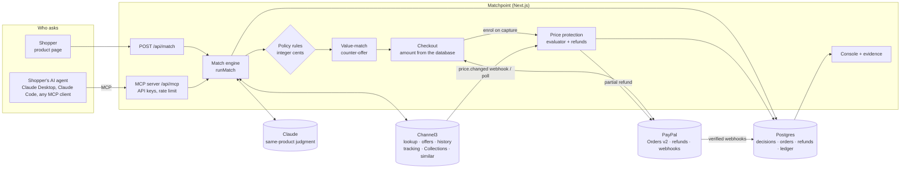

<div align="center">

# 🎾 Matchpoint

### The independent shop's negotiating agent for the age of AI shoppers.

**When a shopper, or their AI agent, finds it cheaper, Matchpoint checks the claim, makes the cheapest fair counter-offer, settles it in PayPal, and refunds the difference if the price drops later.**

[](#works-with-any-mcp-agent)
[](#built-with)
[](#built-with)
[](#built-with)
[](app/)
[](lib/db/)
[](LICENSE)

<a href="docs/media/matchpoint-launch.mp4"></a>

<sub>▶ <a href="docs/media/matchpoint-launch.mp4">Watch the 48-second launch video</a></sub>

</div>

> Shoppers check prices in seconds, and now their AI agents do it for them. A big-box store can price-match anything. An independent shop either loses the sale or matches blindly: it can't tell a real price from an open-box listing, a marketplace seller or a one-day glitch, and every dollar off comes out of a thin margin.
>
> **Matchpoint is the shop's side of that negotiation.** It verifies every claim against [Channel3](https://docs.trychannel3.com) product data, offers store credit before cash when that costs the shop less, creates the [PayPal](https://developer.paypal.com) order at the agreed price, and keeps protecting the sale afterwards. A shopper can ask on the product page, or their agent can ask over MCP.

<p align="center"><b>Big stores match by policy. Matchpoint matches with evidence.</b></p>

Built for the [PayPal AI Hackathon](https://paypalaihackathon.devpost.com). The demo shop is **Larkspur & Co.**, an independent outdoor and audio shop in Portland.

---

## Contents

- [What it does](#what-it-does)
- [See it](#see-it)
- [How it works](#how-it-works)
- [Key ideas](#key-ideas)
- [Works with any MCP agent](#works-with-any-mcp-agent)
- [Quickstart (demo mode, no keys)](#quickstart-demo-mode-no-keys)
- [Live sandbox setup](#live-sandbox-setup)
- [Project structure](#project-structure)
- [Built with](#built-with)

---

## What it does

| | |
|---|---|
| 🔍 **Verifies the claim** | Resolves the competitor's link with Channel3 and checks it's the same product, variant and condition, at an approved store, in stock, and cheaper. Every check names the listing field it read. |
| 📉 **Catches pricing glitches** | Compares the price with 30 days of Channel3 price history. A price seen on one day far below the typical price is declined (or matched at the typical price, if the owner prefers). |
| 🤝 **Counter-offers first** | Before giving cash off, it offers the alternative that costs the shop least and is worth more to the shopper: $60 of store credit instead of $48 off. |
| 💳 **Settles in PayPal** | Creates a PayPal order at the agreed price on the server. The browser or the agent only names the product; the buyer approves the payment themselves. |
| 🛡️ **Protects the sale** | For 14 days, Channel3 price tracking watches the approved stores. A drop becomes a PayPal partial refund, automatic up to $50 and owner-approved above that, with an evidence card. |
| 🤖 **Talks to shopper agents** | An MCP server lets Claude Desktop, Claude Code or any MCP client ask for a match and get back the verdict, the evidence and a PayPal approval link. |
| 🧾 **Shows its work** | The console shows protected sales against refunds paid, every decision with a **via agent** badge where an agent asked, and a versioned policy the owner controls. |

## See it

**The launch video.** Matchpoint in 48 seconds: [docs/media/matchpoint-launch.mp4](docs/media/matchpoint-launch.mp4).

**A match, with a counter-offer.** The Bose QuietComfort Ultra is $407.99 at Larkspur. Best Buy has it at $359.99. Matchpoint checks nine things, then offers $60 of store credit before $48 off:

<p align="center"></p>

<table>
<tr>
<td width="50%" valign="top"><br><sub><b>Not the same deal.</b> The Best Buy link is open-box. Claude cites the URL path, even though the offer's condition field says new.</sub></td>
<td width="50%" valign="top"><br><sub><b>Not a real price.</b> $329.99 appeared on one day in 30; the typical price is $449. Declined as a glitch, with the shop's own new one, still price-protected, offered instead.</sub></td>
</tr>
<tr>
<td width="50%" valign="top"><br><sub><b>The console.</b> Sales covered by protection against refunds paid, match counts, and each decision, with a <b>via agent</b> badge when a shopper's agent asked.</sub></td>
<td width="50%" valign="top"><br><sub><b>The evidence.</b> Every check, Claude's cited reasons, the price history, the counter-offer, the policy version and the order it led to.</sub></td>
</tr>
<tr>
<td width="50%" valign="top"><br><sub><b>Price protection.</b> A drop to $325.99 after the sale becomes an $82 PayPal partial refund. This one is a labelled replay of a recorded Channel3 payload.</sub></td>
<td width="50%" valign="top"><br><sub><b>The owner's rules.</b> Margin floor, maximum discount, refund cap and approved stores. Each save is a new version, and every decision records the one it used.</sub></td>
</tr>
</table>

More: the [shop's home page](docs/screenshots/home.png), the [protection console](docs/screenshots/protection.png), the [order page](docs/screenshots/order.png) and the [product page](docs/screenshots/product.png).

## How it works



1. **Someone asks.** A shopper pastes a link on the product page, or an agent calls `request_price_match`. Both go to the same `runMatch` function.
2. **Channel3 resolves the link** into a canonical product with every store's offers, and loads its 30-day price history.
3. **Claude compares the two listings** with a structured output: same product, variant, condition, bundle, model year, confidence, and reasons that each cite a listing field.
4. **Plain code applies the shop's policy**: approved store, in stock, new, cheaper, not a glitch, and within the margin floor and maximum discount. Any failed check declines; low confidence goes to review.
5. **A match gets a counter-offer**, then a PayPal order at the agreed amount, created on the server. The buyer approves it on PayPal.
6. **The capture enrols price protection** and starts Channel3 price tracking. A later drop at an approved store is evaluated and refunded through PayPal, once per drop.
7. **Everything is saved with its evidence**: the lookup, the history statistics, Claude's output, each check, the policy version and the PayPal IDs.

## Key ideas

### 🧮 Claude judges, code decides
Claude answers one question: are these two listings the same product? Its answer is schema-checked and must cite listing fields. Prices, margins, discounts and refund amounts are integer-cent arithmetic in [`lib/match/rules.ts`](lib/match/rules.ts) and [`lib/protection.ts`](lib/protection.ts). A model error or low confidence sends the request to review; it never approves a match on its own.

### 🤝 Value match before cash match
[`lib/match/value-offer.ts`](lib/match/value-offer.ts) picks the allowed alternative that costs the shop least while being worth at least the cash discount to the shopper. Store credit at $1.25 per $1 off costs the shop only the unit-cost share of what it's spent on. The shopper (or their agent) chooses.

### 📉 Glitch-aware matching
A competitor price is compared with the median of the last 30 daily prices from Channel3. A price at least 20% below typical (10% when Channel3 says the current price is already `low`) that appeared on only one day is treated as a glitch. The owner decides whether glitches are declined or matched at the typical price.

### 💵 The amount always comes from the database
The browser and the agent name a product, a match ID and an option. The server prices the PayPal order from the database, checks the captured amount against it, and refuses a match older than 24 hours. Refunds use a stable `PayPal-Request-Id` per protection and price drop, so a retry or a redelivered webhook can't pay twice.

### 📜 Append-only policy
Every policy change is a new version. Every decision records the version it used, and each refund's evidence names the policy it was judged under, so the evidence pages can always say which rules applied. In live mode, changing the approved stores also updates the shop's Channel3 Collection.

### 🏷️ Simulations are labelled
The demo's price drop is a recorded Channel3 payload replayed with a lower price. It says **simulated** in the console, on the evidence page, in the email and in the PayPal refund note, and it's never counted as an observed store price.

## Works with any MCP agent

`/api/mcp` is a [Model Context Protocol](https://modelcontextprotocol.io) server over Streamable HTTP (stateless, JSON responses). It runs the same engine and checkout as the product page.

| Tool | What it does |
|---|---|
| `list_products` | The catalog, with product IDs, prices and variants. Optional `query`. |
| `request_price_match` | `product`, `competitor_url`, optional `buyer_email` and `option` (`match` or `value`). Returns the decision, each check with its evidence, Claude's cited reasons, the value-match offer and, when matched, a **PayPal approval link**. The agent can't pay: the buyer approves. |
| `get_match_status` | `match_id`. The decision, the order and payment status, and price protection. |

Requests need `Authorization: Bearer <key>` (or `X-API-Key`). Keys come from `MCP_API_KEYS` as comma-separated `name:key` pairs; the name is saved on each decision and shown in the console. Demo mode accepts `mp_demo_key` when `MCP_API_KEYS` is empty. Each key gets 60 requests a minute.

<table>
<tr>
<td width="50%" valign="top">

### Claude Desktop

Settings → Developer → Edit Config, then restart Claude Desktop:

```json
{
  "mcpServers": {
    "larkspur-price-match": {
      "command": "npx",
      "args": ["-y", "mcp-remote",
        "http://localhost:3000/api/mcp",
        "--transport", "http-only",
        "--header", "Authorization:${MATCHPOINT_AUTH}"],
      "env": { "MATCHPOINT_AUTH": "Bearer mp_demo_key" }
    }
  }
}
```

[`mcp-remote`](https://www.npmjs.com/package/mcp-remote) bridges Claude Desktop's stdio to HTTP. The key goes through `env` because spaces inside `args` aren't passed reliably on every platform.

</td>
<td width="50%" valign="top">

### Claude Code

```bash
claude mcp add --transport http larkspur \
  http://localhost:3000/api/mcp \
  --header "Authorization: Bearer mp_demo_key"
```

### From a script

```bash
npm run mcp:try -- http://localhost:3000/api/mcp
```

Connects with the MCP SDK, lists products, asks for a match on the Bose with the recorded Best Buy link and prints the verdict and approval link.

</td>
</tr>
</table>

Then ask, for example: *"I found the Bose QuietComfort Ultra (2nd Gen) for $359.99 at https://www.bestbuy.com/product/bose-quietcomfort-ultra-headphones-2nd-gen-black/J7C5V6W7LP. Ask Larkspur & Co. to match it."* An abridged `request_price_match` result, taking the store credit:

```jsonc
{
  "decision": "match",
  "headline": "Matched: $359.99 from bestbuy.com.",
  "matched_price": "$359.99",
  "savings": "$48.00",
  "reasons": [
    { "check": "Approved store", "status": "pass", "detail": "bestbuy.com is on our list of approved stores.", "evidence": "competitor.url" },
    { "check": "In stock", "status": "pass", "detail": "In stock at bestbuy.com.", "evidence": "competitor.offers[bestbuy.com].availability" }
    // ... 7 more checks, then Claude's cited reasons and the price history
  ],
  "value_offer": { "title": "Store credit", "worth": "$60.00", "instead_of_cash_discount": "$48.00" },
  "checkout": {
    "option": "value",
    "amount": "$407.99",
    "approval_url": "http://localhost:3000/api/checkout/return?orderId=…&token=…",
    "next_step": "Give approval_url to the buyer. They approve the payment in PayPal; the shop captures it and the order is covered by price protection."
  }
}
```

In live mode `approval_url` is PayPal's sandbox approval page. After approval PayPal returns the buyer to `/api/checkout/return`, which captures the payment, enrols price protection and shows the order. In demo mode the link simulates the approval.

## Quickstart (demo mode, no keys)

Demo mode answers every Channel3, PayPal and Claude call from the recorded responses in [`fixtures/`](fixtures), so it needs no API keys and no accounts. You need Node.js 22.12+ and Docker.

```bash
git clone https://github.com/Manas-33/matchpoint.git && cd matchpoint
npm install
cp .env.example .env
npm run db:up          # Postgres in Docker on port 5433, as .env.example expects
npm run db:migrate
npm run seed:demo      # 12 products, the default policy, recorded Channel3 data
npm run dev:demo       # http://localhost:3000
```

Then try:

| Page | What to try |
|---|---|
| [`/products/bose-quietcomfort-ultra-headphones-2nd-gen-mgo7x7f`](http://localhost:3000/products/bose-quietcomfort-ultra-headphones-2nd-gen-mgo7x7f) | Under **Found it cheaper?**, click a recorded link: *Best Buy* matches with a store-credit counter-offer, *Best Buy open-box* declines on condition, *Crutchfield one-day low* (a hand-built demo case) declines as a glitch. Check out with the simulated PayPal button. |
| Claude Desktop or `npm run mcp:try` | Ask for the same match as an agent (see above), then open the approval link. |
| [`/admin/protection`](http://localhost:3000/admin/protection) | On the paid order, click **Replay recorded drop (simulated)**. A refund over $50 waits for **Approve**; then open its **Evidence**. |
| [`/admin`](http://localhost:3000/admin) | Covered sales vs refunds paid, match counts and the decision feed. |
| [`/admin/policy`](http://localhost:3000/admin/policy) | Set **Maximum discount** to 10 and save: the same Best Buy link now declines under version 2. Set it back and it matches again. |

`npm run seed:demo -- --reset` empties every table and starts over.

<details>
<summary><b>Run the checks</b></summary>

```bash
npm test               # Vitest: rules, money maths, MCP tools, policy versions; Postgres tests run in rolled-back transactions when a database is reachable
npm run lint
npm run typecheck
```

</details>

## Live sandbox setup

Set `DEMO_MODE=false` (the default) in `.env` and fill in the keys. Live mode refuses to start without the PayPal, Channel3 and Anthropic keys and says which one is missing ([`lib/env.ts`](lib/env.ts)).

| Key | Where to get it |
|---|---|
| `PAYPAL_CLIENT_ID`, `PAYPAL_CLIENT_SECRET` | [developer.paypal.com](https://developer.paypal.com) → Apps & Credentials → **Sandbox** → create an app. |
| `CHANNEL3_API_KEY` | [trychannel3.com](https://trychannel3.com/dashboard) → API keys. |
| `ANTHROPIC_API_KEY` | [console.anthropic.com](https://console.anthropic.com) → API keys. `ANTHROPIC_MODEL` defaults to `claude-sonnet-5-5`. |
| `PAYPAL_WEBHOOK_ID` (optional) | After adding `https://<public host>/api/webhooks/paypal` as a webhook on the sandbox app. |
| `CHANNEL3_WEBHOOK_SECRET` (optional) | The `whsec_...` secret of a Channel3 webhook endpoint at `https://<public host>/api/webhooks/channel3`. |
| `MCP_API_KEYS` | Your own `name:key` pairs for agents, e.g. `claude-desktop:<long random string>`. |
| `RESEND_API_KEY` (optional) | [resend.com](https://resend.com). Without it, evidence emails are logged. |

```bash
npm run seed           # live Channel3 data; also creates the "Matchpoint approved stores" Collection
npm run dev
```

Pay with a PayPal sandbox **personal** account (developer.paypal.com → Sandbox → Accounts). Live prices move, so a link that matched yesterday may decline today; the recorded demo cases don't change.

<details>
<summary><b>Webhooks and background jobs</b></summary>

Expose the app with a tunnel (e.g. `ngrok http 3000`), set `APP_URL` to the tunnel URL, and add the two webhook URLs above.

- **PayPal** deliveries are verified with `verify-webhook-signature` and stored once per event ID in `ledger_events`. Unverified deliveries are kept, flagged and refused so PayPal retries. `npm run webhooks:replay` re-sends the recorded deliveries.
- **Channel3** `price.changed` deliveries are verified with their Svix signature and evaluated against active protections.
- Without webhooks, **Run price check now** in the protection console (or `npm run protection:check`) polls Channel3 history and offers instead. `npm run protection:backfill` enrols captured orders that were missed, and `npm run protection:replay -- <protectionId>` replays the labelled simulated drop.

</details>

## Project structure

```
matchpoint/
├── app/                     # Next.js App Router
│   ├── products/ checkout/ orders/   # the storefront
│   ├── admin/               #   console: overview, policy, price protection
│   ├── matches/ evidence/   #   evidence for each decision and each refund
│   └── api/
│       ├── match/           #   POST /api/match (JSON, or NDJSON progress with ?stream=1)
│       ├── mcp/             #   the shopper-agent MCP server
│       ├── checkout/        #   create and capture orders; /return captures after PayPal approval
│       └── webhooks/        #   PayPal and Channel3
├── lib/
│   ├── match/               # engine, policy rules, value-match counter-offer, demo cases
│   ├── mcp/                 # MCP tools, API keys, rate limit
│   ├── price-protection.ts  # enrolment, price events, refunds (lib/protection.ts is the pure evaluator)
│   ├── policy-admin.ts      # policy form and versions
│   ├── paypal.ts            # PayPal Server SDK client and its demo stand-in
│   ├── channel3.ts          # Channel3 client and its demo stand-in
│   ├── claude.ts            # same-product judgment
│   └── db/                  # Drizzle schema (migrations in drizzle/)
├── fixtures/                # recorded API responses, secrets redacted, for demo mode and tests
├── scripts/                 # seed, recording, replay, MCP check; Phase 0 spikes
└── docs/                    # README screenshots and the launch video
```

Further reading: [IDEA.md](IDEA.md) · [PLAN.md](PLAN.md) · [scripts/spikes/FINDINGS.md](scripts/spikes/FINDINGS.md)

## Built with

| | |
|---|---|
|  | **Lookup** resolves any product URL into a canonical product with every store's **offers**. **Price history** with `statistics.current_status` powers the glitch check. **Price tracking** and the `price.changed` **webhook** drive price protection (for products in Channel3's catalog), with a poll as fallback. The approved stores are a **Collection**, and **`similar`** suggests stocked alternatives on a decline. |
|  | **Orders v2** (create, capture) and **partial refunds** through [`@paypal/paypal-server-sdk`](https://github.com/paypal/PayPal-TypeScript-Server-SDK). **Verified webhooks** (`verify-webhook-signature`) feed a de-duplicated ledger. The **JS SDK v6** renders the buttons on the shop's checkout; agents get the order's approval link instead. |
|  | The PayPal Server SDK is **APIMatic-generated**, and the integration was built with APIMatic's **PayPal Context Plugin**. |
|  | The same-product judgment, via `@anthropic-ai/sdk` with **structured outputs** parsed against a Zod schema. The model comes from `ANTHROPIC_MODEL` (default `claude-sonnet-5-5`). |
|  | `@modelcontextprotocol/sdk` over Streamable HTTP, so any shopper's agent can negotiate with the shop. |

**Also:** Next.js 16 (App Router, TypeScript), Tailwind CSS, Postgres with Drizzle ORM (money in integer cents, rates in basis points), Resend for email, Vitest.

## Commission disclosure

Channel3 product data includes buy links (`buy.trychannel3.com`) that are affiliate links: a purchase through one may earn a commission. Matchpoint doesn't send shoppers through those links: it links only to the shop's own pages and to the competitor URL the shopper gave it. If you add Channel3 buy links to a storefront, show a commission disclosure next to them.

## License

[MIT](LICENSE)

<p align="center"><sub>🎾 Game, set, matched.</sub></p>
